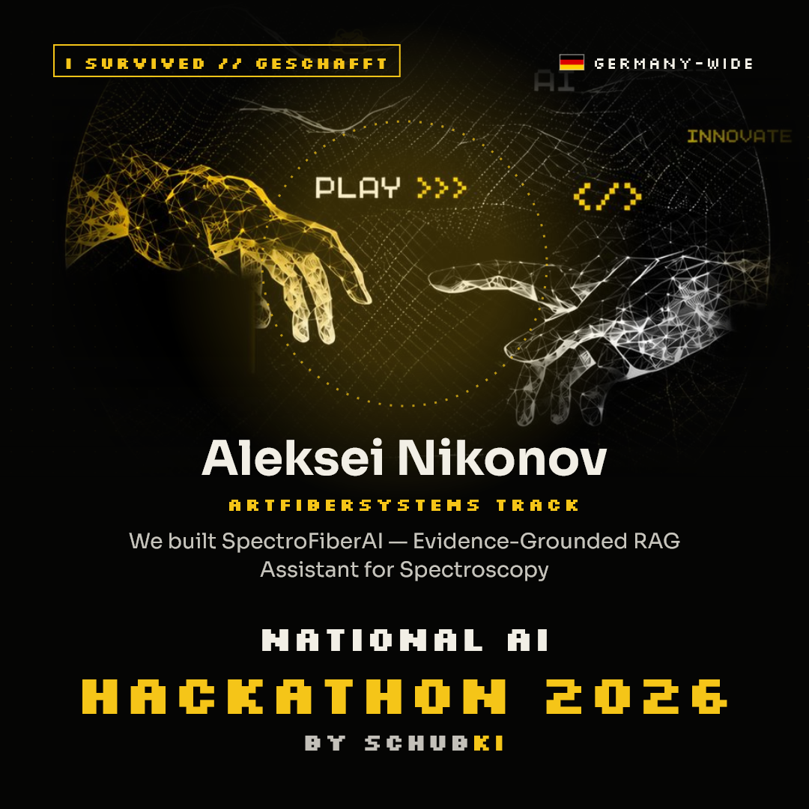

# Spectro-AI

**Provisional spectroscopy use-case assessment for AFS experts.** Spectro-AI turns a customer enquiry into an expert-reviewable report using an explicitly configured language model and a local, source-linked knowledge base.

> This is a hackathon prototype, not a validated scientific instrument or autonomous recommendation system. Results are exploratory and require expert review, representative samples, and independent reference measurements. Software checks and citations do not establish scientific suitability.



## What it does

1. Extracts requirements and exact customer quotations from a natural-language enquiry.
2. Retrieves relevant passages from an explicitly maintained local knowledge base.
3. Assesses technical possibilities and missing information with Ollama or OpenAI.
4. Applies deterministic validation and presents evidence, diagnostics, and a feasibility plan for expert review.
5. Exports the customer report as Markdown and the structured audit trail as JSON.

Unknown values remain unknown; the application can abstain when facts or evidence are insufficient. It does not invent customer specifications, units, scientific confidence, or a fallback recommendation.

## Quick start (Windows PowerShell)

Requirements: Windows, CPython 3.14, [uv](https://docs.astral.sh/uv/), [Ollama](https://ollama.com/), and the model resources below. From the repository root:

```powershell
py -3.14 -m venv .tools
.\.tools\Scripts\python.exe -m pip install uv==0.13.1
$env:Path = "$PWD\.tools\Scripts;$env:Path"
$env:UV_CACHE_DIR = Join-Path $PWD '.cache\uv'
$env:UV_PYTHON_DOWNLOADS = 'never'

uv sync --locked --extra rag
ollama pull gemma4:12b-it-q4_K_M
ollama pull qwen3-embedding:0.6b
ollama serve
```

In another PowerShell window, add authorized source documents and start the app:

```powershell
# Add source files listed in knowledge/sources.yaml under knowledge/data/materials/.
uv run python -m spectro_ai.evidence reindex
uv run streamlit run app.py
```

Open the local Streamlit URL shown in the terminal. You can also add authorized PDF, Markdown, and TXT files under `documents/`. Source documents are ignored by Git and are not included in this repository. Use **Update Knowledge Base** in the app after changing source files.

The four synthetic examples are sample customer enquiries; each uses the same model and evidence workflow as custom input. Ollama must be running at `OLLAMA_BASE_URL` (default `http://127.0.0.1:11434`). The default assessment model is `gemma4:12b-it-q4_K_M`; local embeddings use `qwen3-embedding:0.6b`.

## OpenAI option

Assessment can use OpenAI instead of Ollama. Install the optional SDK and set credentials securely in the current process:

```powershell
uv sync --locked --extra rag --extra llm
$env:SPECTRO_AI_PROVIDER = 'openai'
$env:OPENAI_MODEL = '<model supporting Chat Completions structured outputs>'
$env:OPENAI_API_KEY = '<your key>'
uv run streamlit run app.py
```

`OPENAI_BASE_URL` defaults to `https://api.openai.com/v1`. Customer enquiries, extracted facts, and selected source excerpts are sent to the configured assessment endpoint. Local knowledge-base embeddings still use Ollama. No provider fallback occurs. See [OpenAI structured outputs](https://developers.openai.com/api/docs/guides/structured-outputs?api-mode=chat).

Copy `.env.example` to review available settings; `.env` is not loaded automatically. Never commit API keys or customer documents.

## Review and data handling

The app shows extracted facts and quotations, missing information, candidates, retrieved evidence, validation diagnostics, and a feasibility plan. Experts can correct extracted facts and rerun assessment. The **Prompts and queries** tab exposes the latest run's outgoing model requests and selected excerpts for review; traces stay in browser-session memory and are not included in report downloads.

The knowledge base is a local SQLite index (`.cache/rag/index.sqlite3` by default). Index updates are explicit and staged before replacement. Reports bind to the index revision used to create them. Similarity scores are retrieval signals, not scientific confidence. Scanned PDFs require OCR before ingestion.

For technical behavior, limitations, and current acceptance status, see [architecture](docs/ARCHITECTURE.md), [decisions](docs/DECISIONS.md), [source review](docs/AFS_SOURCE_REVIEW.md), and the [hackathon plan](docs/HACKATHON_PLAN.md).

## Development

Install the project and development tools, then run the offline checks:

```powershell
uv sync --locked --extra rag --group dev
uv run pytest
uv run ruff check .
uv run ruff format --check .
uv run python scripts/smoke_check.py
```

Tests use injected provider doubles and do not require API credentials or network access. Live evaluations do require a configured provider and prepared knowledge index; see [evaluation instructions](docs/EVALUATION.md) and the latest [LLM evaluation report](docs/LLM_EVALUATION.md). The current scientific review and unresolved gates are documented in the [assessment review](docs/ASSESSMENT_REVIEW.md).

## License

See [LICENSE](LICENSE).
